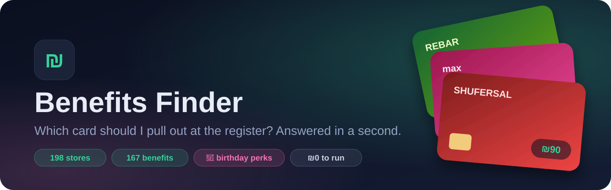
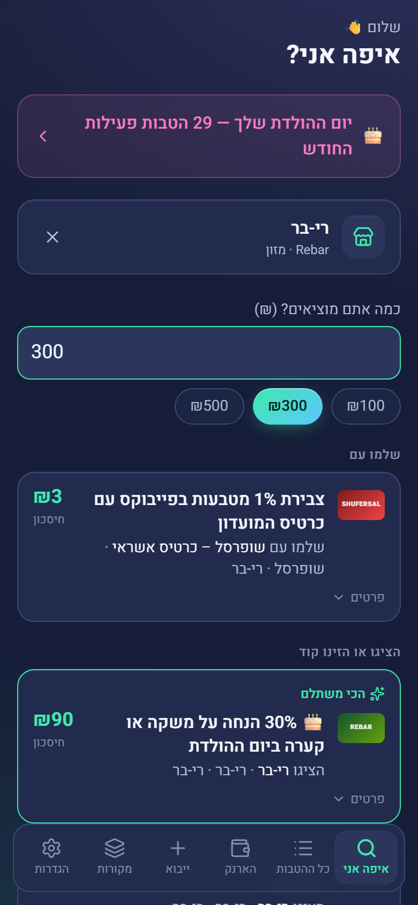
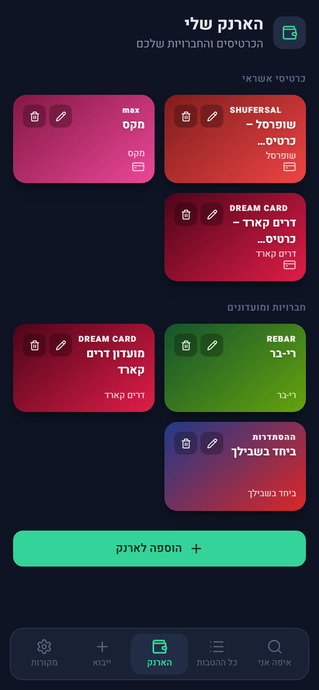
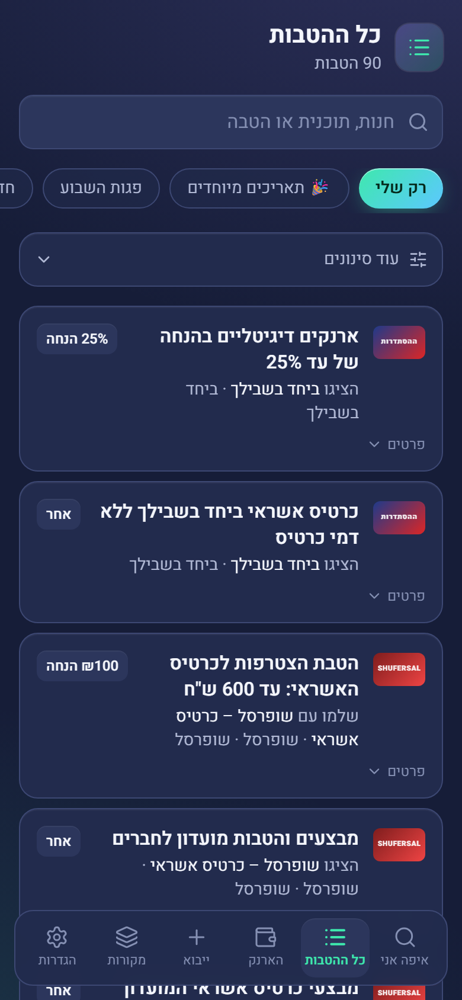
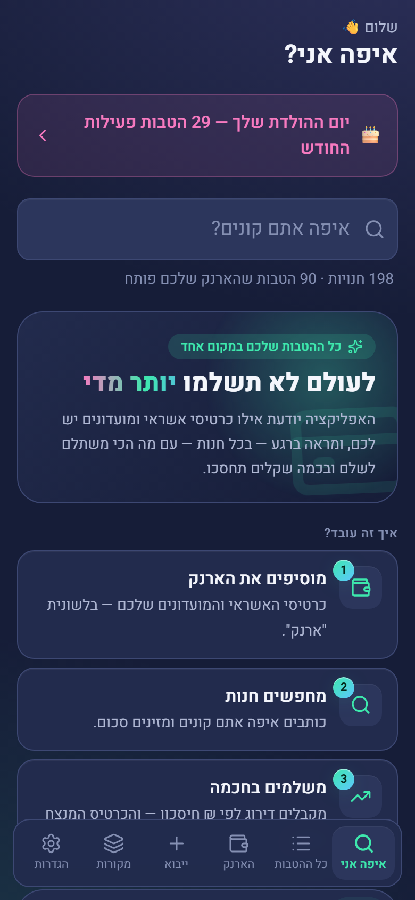
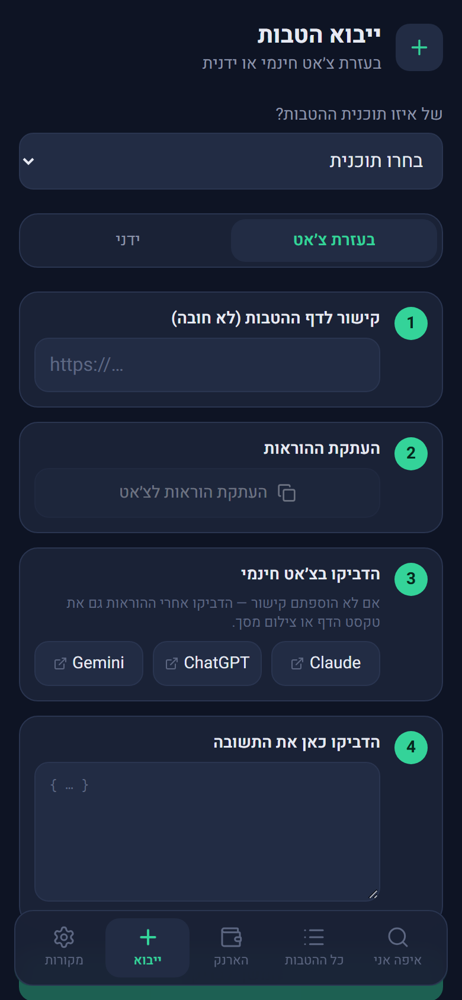
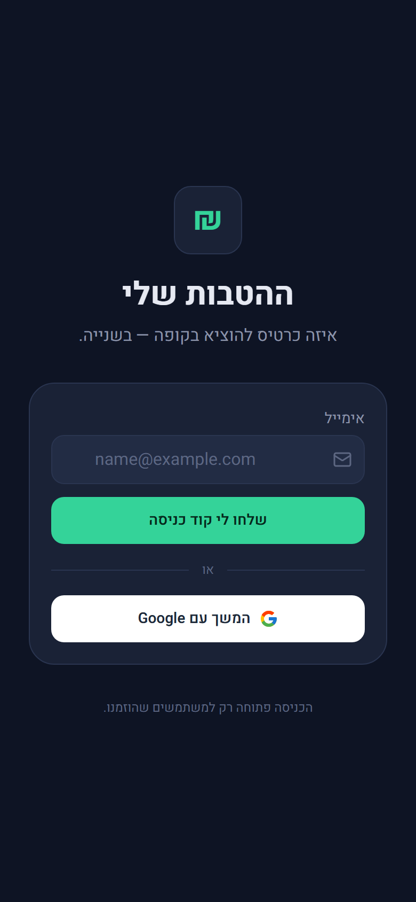
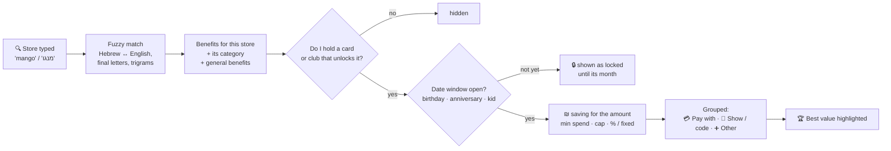
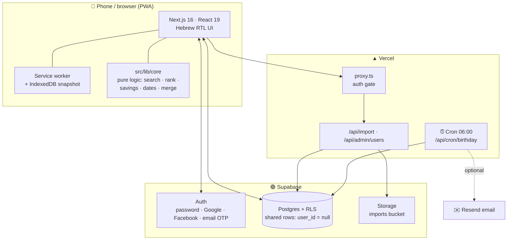
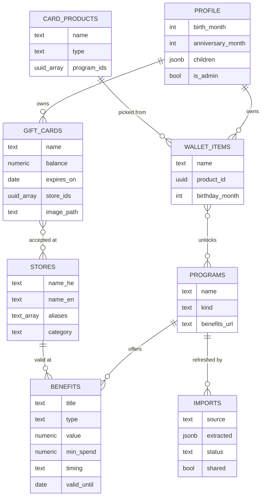

<div align="center">



<h3>ההטבות שלי · <i>Your Israeli credit-card & club benefits, in one place</i></h3>

<p>
  <a href="https://benefits-finder-swart.vercel.app"></a>
  
  
</p>

<p>
  
  
  
  
  
  
  
</p>

<b><a href="#-what-it-does">What it does</a> ·
<a href="#-screenshots">Screenshots</a> ·
<a href="#-how-the-best-card-is-chosen">How it works</a> ·
<a href="#-getting-started">Getting started</a> ·
<a href="#-roadmap">Roadmap</a> ·
<a href="#-faq">FAQ</a></b>

</div>

---

## 💡 The problem

Every Israeli wallet is full of plastic: a Max card, a Cal card, a supermarket credit card, Rebar and Delta+ clubs, the Histadrut card, a workplace benefits program… Each one hides dozens of discounts, cashback deals and birthday gifts on websites nobody reads.

So at the register you guess. You pay with whatever card is on top and walk away from money you were entitled to.

**Benefits Finder fixes that.** Tell it once which cards and clubs you have. From then on, type the store you're in, and it tells you **which card to pay with, what to show, and how many shekels you'll save**.

---

## ✨ What it does

<table>
<tr>
<td width="50%" valign="top">

### 🔍 "Where am I?"
Type a store in **Hebrew or English**, even with typos: `mango`, `Mango`, `מנגו`, `מקדונלדס` and `McDonald's` all work. Enter what you're spending (a quick ₪100/300/500 chip or Enter drops the keyboard) and every benefit you hold is ranked by **real ₪ savings**. The winner is lifted to the top as **one answer**: "show your Rebar card" or "pay with Max", the ₪ saved and how, and the coupon code to copy. Everything else follows under "עוד אפשרויות". The store and amount live in the URL (`/?store=…&amount=…`), so switching tabs keeps them and a link opens straight to that store. Before you pick a store, home shows **your own things**: your last 5 stores as one-tap chips, gift cards about to expire, and a small "שאלו את העוזר" row that opens the AI chat.

</td>
<td width="50%" valign="top">

### 💳 My wallet
Pick your cards and clubs from a shared catalog and they appear as **brand-style cards** (Max pink, Shufersal red, Rebar green…). Each card unlocks its benefits immediately. No typing and no setup per user. A new user picks cards first, before being asked for anything personal, and only then the birth month.

</td>
</tr>
<tr>
<td valign="top">

### 📋 All benefits
Every benefit you can use, with **search plus filters**: only mine, card or club, issuer, category, benefit type, online vs. in-store, special dates and expiring this week. Each one shows the conditions, minimum spend, discount cap, coupon code and source link.

</td>
<td valign="top">

### 🎂 Special dates
Birthday month, your **club "birthday" month** (when a club uses a different one), **wedding anniversary** and **each child's birthday**. A banner appears when a window opens, benefits that are locked until their month say so, and an optional email reminder goes out.

</td>
</tr>
<tr>
<td valign="top">

### ➕ Free import, no AI bill
Got a card the catalog doesn't cover? The app writes a ready-made prompt. Paste it into **any free chatbot** (ChatGPT, Gemini, Claude) together with the benefits page, then paste the answer back. You review every row before it's saved. Manual entry works too.

</td>
<td valign="top">

### 👥 Shared catalog + private extras
Admins keep one **shared catalog** of programs, stores and benefits that everyone sees. Each user can add **private** benefits that only they see. Anyone can **sign up**; admins can also add people from an in-app admin screen.

</td>
</tr>
<tr>
<td valign="top">

### 📶 Works offline
It's an installable **PWA**. Your last snapshot is stored on the device (IndexedDB plus a service worker), so the app still answers in a basement supermarket with no signal. Online, the stored copy is only shown to the account it belongs to, so a shared phone never flashes someone else's wallet.

</td>
<td valign="top">

### 🔐 Easy, safe sign-in
Sign up or sign in with **email and password**, **Google**, **Facebook** or a **6-digit email code** (which doubles as "forgot password"; a password can be set later in Settings), next to a collage of real cards, club logos and ₪ coins (half the screen on a desktop, a header on a phone). The form works with a screen reader and a keyboard alone: labelled fields, a show-password toggle, errors announced as they appear. Postgres **row-level security** means users can never read each other's private data. Only admins can write to the shared catalog, and the database enforces that too.

</td>
</tr>
<tr>
<td valign="top">

### 🎁 Gift cards
Keep every gift card in one place: BuyMe, תו הזהב, store cards and the rest. Add one by **pasting its link**, **uploading a screenshot** (AI fills in the details) or **typing it in**, or start from a preset for the most popular cards. It keeps the balance left, the expiry date, the code, a photo of the card to show at the register, and which stores accept it, with a Google search to find them. Before a card with money left expires you get a **reminder** 30, 7 and 1 days ahead, plus a banner on the home screen.

</td>
<td valign="top">

### 🧾 Gift card + best discount
At a store, enter the amount and the app tells you **which gift card to use** and what's left to pay: `price − gift card − best discount`. It uses the soonest-expiring card first, and knows that a "pay with card" discount only applies to the part the card pays.

</td>
</tr>
</table>

---

## 📸 Screenshots

<div align="center">
<table>
<tr>
<td align="center"><br/><sub><b>Which card here?</b><br/>₪ savings for ₪300 at Rebar</sub></td>
<td align="center"><br/><sub><b>My wallet</b><br/>brand-style card art</sub></td>
<td align="center"><br/><sub><b>All benefits</b><br/>search + filters</sub></td>
</tr>
<tr>
<td align="center"><br/><sub><b>Home</b><br/>birthday month banner 🎂</sub></td>
<td align="center"><br/><sub><b>Import</b><br/>free chatbot or manual</sub></td>
<td align="center"><br/><sub><b>Sign in</b><br/>password, Google, Facebook or email code</sub></td>
</tr>
</table>
<sub>Screenshots predate the focused home, the 4-tab nav and the login collage.</sub>
</div>

---

## 🧮 How the best card is chosen



| Benefit type | How the ₪ saving is computed (for amount **A**) |
|---|---|
| `percent_off`, `cashback_percent` | `A × value%`, capped by `max_discount` |
| a % on **one item** ("30% on a drink or bowl") | shown as "30% על פריט אחד" (plus "עד ₪X" when capped) but not ranked by ₪ and never "best", because a basket-wide number would be made up; spotted from the benefit's wording, and flagged in import review |
| `fixed_off` | `value`, only if `A ≥ min_spend` |
| `points`, `bogo`, `gift`, `installments`, `other` | shown but not ranked by ₪, because no honest number exists |

Every ₪ figure carries a one-line "how we got this" under it, for the amount entered: `30% × ₪300`, `10% × ₪300, עד ₪50`, `₪20 בקנייה מעל ₪100`. The best card also says why it won ("החיסכון הגדול ביותר עבור ₪300").

**With gift cards** the app compares two ways to pay and shows the cheaper one:
- show a club / enter a coupon (discount on the full price), then pay with gift cards;
- pay with gift cards first, then pay what's left with a card, whose discount applies only to that part.

Dates are always evaluated in **Asia/Jerusalem** time. A birthday benefit is valid **for the whole birth month**: born on 21.9 means the benefit runs from 1.9 to 30.9.

---

## 🏗️ Architecture



**Design choices worth knowing**

- **All business logic is pure TypeScript** in [`src/lib/core`](src/lib/core) with no React and no database, so it's fully unit tested.
- **One table per concept, with sharing built in.** `programs`, `stores` and `benefits` rows with `user_id = null` are the shared catalog, and rows with a `user_id` are private. Row-level security does the rest.
- **Admin rights live in the database.** `is_admin()` is a security-definer function, and the `profile.is_admin` column is not grantable to users, so nobody can promote themselves.
- **No paid APIs needed.** The chatbot import works on the free tier of any chatbot. A paid Claude import path exists but is off unless `NEXT_PUBLIC_AI_API=on`.

### Data model



---

## 🚀 Getting started

### 1. Prerequisites
- Node.js **22+**
- A free [Supabase](https://supabase.com) project
- *(optional)* a free [Vercel](https://vercel.com) account for hosting, and a [Resend](https://resend.com) key for reminder emails

### 2. Install

```bash
git clone https://github.com/Gabrielab5/benefits-finder.git
cd benefits-finder
npm install
```

### 3. Database
In the Supabase SQL editor, run every file in [`supabase/migrations`](supabase/migrations) **in order** (oldest first):

1. `20261006000000_init.sql` creates the tables, RLS and storage bucket
2. `20261007000000_shared_catalog.sql` adds the shared catalog, special dates and admin role
3. `20261011000000_push.sql` adds push notification devices and settings
4. `20261013000000_gift_cards.sql` and `20261013000001_gift_card_image.sql` add gift cards and their photos

Then in **Authentication**:
- **Sign In / Providers**: turn on **Allow new users to sign up** (turn it off to go back to invite-only; the login page follows on its own) and enable **Email**, keeping *Confirm email* on.
- *(optional)* enable **Google** and **Facebook**. Facebook needs a [Meta app](https://developers.facebook.com/apps) with *Facebook Login*: paste its App ID and App secret into Supabase, and add the callback URL Supabase shows to the app's *Valid OAuth Redirect URIs*. The login page only shows the providers that are switched on.
- **Emails**: make sure both **Confirm signup** and **Magic link** include `{{ .Token }}`, so the email carries the 6-digit code the login page asks for.

### 4. Environment
Copy [`.env.example`](.env.example) to `.env.local` and fill it in:

| Variable | Required | What it is |
|---|:-:|---|
| `NEXT_PUBLIC_SUPABASE_URL` | ✅ | Project URL, e.g. `https://xyz.supabase.co` (no `/rest/v1`) |
| `NEXT_PUBLIC_SUPABASE_PUBLISHABLE_KEY` | ✅ | Publishable (anon) key |
| `SUPABASE_SECRET_KEY` | ✅ | Secret key: server only, never exposed to the browser |
| `CRON_SECRET` | ✅ | Any long random string; protects the cron endpoint |
| `APP_URL` | ✅ | Public URL of the app, used in emails |
| `RESEND_API_KEY` / `RESEND_FROM` | ➖ | Only for birthday and special-date reminder emails |
| `ANTHROPIC_API_KEY` / `NEXT_PUBLIC_AI_API` | ➖ | Only for the paid AI import (`on` to enable) |
| `GEMINI_API_KEY` | ➖ | AI chat on the home page and reading gift cards from a link or screenshot (free key from Google AI Studio; `GEMINI_MODEL` optional) |
| `E2E_EMAIL` | ➖ | Test user for e2e tests. **Must contain `e2e`**, because the test wipes that user |

> [!CAUTION]
> Never commit `.env.local` or any `client_secret_*.json`. Both are git-ignored.

### 5. Run

```bash
npm run dev
```

Open http://localhost:3000, sign in, and the onboarding flow walks you through two steps: first a three-line "how it works" and your cards and clubs (grouped into credit cards, clubs and store clubs, with a search that takes Hebrew or English names and a field for anything missing), then your birth month (required) plus an optional anniversary and children's birthdays.

### 6. Make yourself admin
Set `is_admin = true` on your row in the `profile` table once (SQL editor). The **Sources** tab then shows the admin panel for inviting users and the "shared" toggle on imports.

---

## 🧪 Testing

| Command | What it covers |
|---|---|
| `npm test` | ~150 unit tests: search, ranking, savings, dates, merge, import parsing, catalog rules |
| `npm run test:db` | Row-level security against a real Supabase: users can't see or edit each other's data, and only admins can write to the shared catalog |
| `npm run e2e` | Playwright: the full "search a store → best card first" flow (kept across a tab switch) and new-user onboarding |
| `npm run test:ai` | Regression tests for the optional paid AI extraction |
| `npm run lint` | ESLint |

Every pull request runs `lint`, `test` and `build` on GitHub Actions ([`ci.yml`](.github/workflows/ci.yml)); a PR merges only when they pass.

---

## ☁️ Deployment

The app is hosted on **Vercel** and connected to this repo:

- push to `master` → **production** at https://benefits-finder-swart.vercel.app
- push to any other branch → a **preview** URL
- [`vercel.json`](vercel.json) schedules the daily reminder cron at **06:00 UTC**

Add the same environment variables in **Vercel → Settings → Environment Variables**, and add the production URL to **Supabase → Authentication → URL configuration** (Site URL and Redirect URLs).

### Keeping benefits fresh
Benefits change all the time. [`scripts/monthly-refresh.md`](scripts/monthly-refresh.md) describes the monthly refresh: re-research each program, load the results as **pending imports** with [`scripts/load-researched-benefits.mjs`](scripts/load-researched-benefits.mjs), review them in the app and approve. Nothing reaches users without a human review.

The store list itself comes from [`docs/research/israel-chains-loyalty-clubs.md`](docs/research/israel-chains-loyalty-clubs.md): about 300 Israeli store and restaurant chains by category, whether each has its own club, and the club benefits with their sources. New chains go into [`src/lib/seedStores.ts`](src/lib/seedStores.ts) and reach the shared catalog with `npx tsx scripts/add-seed-stores.mts` (safe to re-run, skips any spelling that's already there). New store clubs go in with [`scripts/add-shared-clubs.mjs`](scripts/add-shared-clubs.mjs), and their benefits through the same pending-import review.

---

## 📁 Project structure

```text
src/
├─ app/
│  ├─ (tabs)/            # 4 bottom-nav tabs: איפה אני · הטבות · ארנק · עוד
│  │  ├─ page.tsx        # 🔍 Where am I?
│  │  ├─ benefits/       # 📋 All benefits
│  │  ├─ wallet/         # 💳 My wallet (+ gift-cards/)
│  │  ├─ more/           # ⋯ "עוד": links to the three screens below
│  │  ├─ import/         # ➕ Add benefits (import + review)
│  │  ├─ sources/        # 📚 The catalog: programs and their benefits
│  │  └─ settings/       # ⚙️ Dates, notifications, sign-out, admin
│  ├─ login/ onboarding/ auth/
│  └─ api/               # import · giftcards/extract · chat · admin/users · cron/birthday
├─ components/           # BenefitCard, DatesForm, AdminPanel, LoginCollage, ui
├─ lib/
│  ├─ core/              # 🧠 pure, tested business logic
│  ├─ ai/                # chatbot prompt + answer parser (+ optional paid AI)
│  ├─ email/             # reminder email builder
│  └─ snapshot.ts …      # data loading + offline cache
└─ proxy.ts              # auth gate (Next 16's middleware)
public/login/            # the login collage's card, logo and photo images
supabase/migrations/     # schema + RLS
scripts/                 # catalog loading, refresh, README screenshots
tests/                   # db (RLS) + e2e (Playwright)
```

---

## 🗺️ Roadmap

Ideas collected from real use and from "wouldn't it be cool if…". ✅ = done, 🔜 = next up, 💭 = exploring.

### 🛒 At the register
- ✅ **Focused home and 4-tab nav**: recent stores and expiring gift cards instead of a landing page, the AI chat one tap away, and Import, Catalog and Settings under "עוד"
- 🔜 **Near me**: open the app inside a mall and the stores around you are suggested automatically (geolocation, on-device only)
- 🔜 **Home-screen shortcut and widget**: one tap from the lock screen to the store search
- 🔜 **Voice search**: say "שופרסל" and get the answer hands-free
- 💭 **Split-payment advice**: "pay ₪200 with Max to hit the minimum, the rest with Cal"
- 💭 **Online checkout helper**: a browser extension that detects the shop's site and shows the best card and coupon code
- 💭 **Scan a receipt** to see what you *could* have saved

### 💳 Wallet & benefits
- ✅ Brand-style card art, shared catalog, private benefits
- ✅ **Gift cards**: store them (link, screenshot or manual), track the balance left, and get "use this gift card + this discount" at the register
- 💭 **BuyMe sync**: BuyMe has no public API for consumers yet, so cards come in by link or screenshot
- 🔜 **More cards in the catalog**: Isracard variants, Amex, Leumi Card, bank-branded and fuel-company cards, El Al and airline clubs, Hever, workers' committees, student and IDF/reservist benefits
- 🔜 **Points and miles value**: estimate the ₪ worth of points, so points benefits can be ranked too
- 🔜 **Expiry alerts**: "3 benefits you hold end this week"
- 🔜 **Favorites and "used it" history**, so you know which benefits you actually use
- 💭 **Annual fee vs. value report**: "this card cost you ₪240 a year and saved you ₪610"
- 💭 **"Which card should I get?"**: compare your spending with cards you *don't* have yet

### 🎂 Special dates
- ✅ Birthday, club birthday month, wedding anniversary, children's birthdays
- ✅ **Push notifications**: special dates, benefits expiring this week, gift cards about to expire (30 / 7 / 1 days ahead), new benefits for your cards (free, no Resend key needed)
- 🔜 **Holiday sales calendar**: Black Friday, Pesach and Rosh Hashana sales, back-to-school
- 💭 **Partner's birthday and pets** 🐶 (pet-store clubs have birthday perks too)

### 🔄 Keeping data fresh
- ✅ Monthly human-reviewed refresh
- 🔜 **"Report a wrong benefit"** button, so users can flag stale or broken deals for the admin
- 🔜 **Suggest a benefit**: users submit a deal they found; an admin approves it into the shared catalog
- 💭 **Automatic change detection** on issuers' benefit pages, so only changed pages need review
- 💭 **Community confirmations**: "worked for me ✅ / didn't work ❌" with a date

### 👪 Family & sharing
- 🔜 **Family wallet**: see your partner's cards too ("your spouse's Shufersal card gives more here")
- 💭 **Share a benefit** to WhatsApp in one tap

### 🌍 Reach & polish
- ✅ **Instant feedback**: every button shows it was tapped, and longer waits (login, reading a gift card, importing) get a loading screen with a catch-the-shekels mini game 🪙
- ✅ **Open sign-up**: email and password, Facebook, Google or an email code, and a password can be added later in Settings
- ✅ **A sign-in page that shows what the app is about**: a collage of real cards, club logos and ₪ coins beside the form, which settles in once on load
- 🔜 **English and Arabic UI** (the search already understands English)
- 🔜 **Light theme** next to the current dark one
- ✅ **Accessibility pass**: screen-reader labels (the best card is announced as it changes), contrast (all text at least 4.5:1, card art included), 44px tap targets, a visible focus ring, and focus that follows the task (a form that opens scrolls into view, a picked store moves you to the amount)
- ✅ **First run for a stranger**: cards before dates, a three-line "how it works", and empty states that say why and what to do next (empty wallet, no gift cards, no benefits for the current filters)
- 🔜 **Larger text mode**
- 💭 **Native app wrapper** for the App Store and Google Play
- 💭 **Open sign-up** with a waiting list, once the catalog is broad enough

### 🛠️ Under the hood
- 🔜 Children keyed by id rather than name (two kids with the same name)
- 🔜 Admin: clearer error messages when an invite fails, and cleanup of a removed user's uploads
- 🔜 Automatic DB backups and a restore script
- 💭 Usage analytics that respect privacy (no third-party trackers)

> Have an idea? Open an [issue](https://github.com/Gabrielab5/benefits-finder/issues) and it may land here.

---

## ❓ FAQ

<details>
<summary><b>Does it connect to my bank or credit card account?</b></summary>
<br/>
No, never. The app only knows <i>which</i> cards and clubs you hold, because you picked them. It never asks for full card numbers, account logins or transactions. At most it keeps an optional last 4 digits, so you can tell two similar cards apart.
</details>

<details>
<summary><b>Where do the benefits come from?</b></summary>
<br/>
From each issuer's and club's public benefits pages. Research is loaded as pending imports and a human approves each one. Every benefit links to its source so you can check it.
</details>

<details>
<summary><b>Is a benefit guaranteed to work?</b></summary>
<br/>
No. Issuers change terms without notice. Treat the app as a smart reminder, and check the conditions (shown under <b>פרטים</b>, "details") or the source link before relying on a deal.
</details>

<details>
<summary><b>Why does it cost nothing to run?</b></summary>
<br/>
Supabase and Vercel free tiers cover a small group comfortably, and the import uses whatever free chatbot you already have instead of a paid AI API.
</details>

<details>
<summary><b>Can I add a card that isn't in the catalog?</b></summary>
<br/>
Yes. In <b>Wallet → Add → "משהו אחר (פרטי)"</b> ("something else, private"), create a custom item, then add its benefits in <b>Import</b>, using the free chatbot flow or by hand. They stay private to you.
</details>

<details>
<summary><b>How do I get access?</b></summary>
<br/>
Open the app and create an account with your email and a password, or continue with Google or Facebook.
</details>

---

<div align="center">

Made with 💚 in Israel · Hebrew-first, RTL-native · Built with Next.js, Supabase and Vercel

<sub>Not affiliated with any card issuer, bank or club. Brand names and colors are used only to help you recognize your own cards. The logos and card images on the login page belong to their owners and are shown for illustration only.</sub>

</div>
